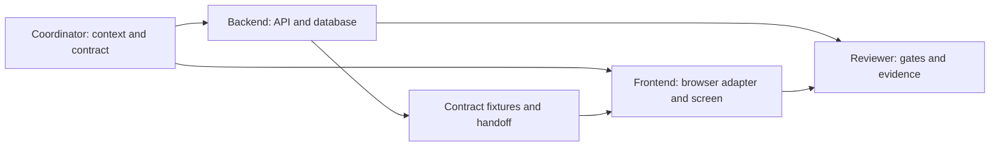

# Ownership and handoffs

Read root instructions first. Roles can be sequential in one session; they require no application agent framework or model keys. Do not spawn agents unless explicitly requested for that run.

| Role | Allowed edits | Required reads | Excluded edits |
| --- | --- | --- | --- |
| Context coordinator | `context/`, `contracts/`, root/directory instructions | Both applications and task evidence | Application source, secrets, live data |
| Backend engineer | `backend/` including owned tests/infra | Contract, context, frontend behavior | `frontend/`, shared contract/instructions |
| Frontend integrator | `frontend/` code/tests | Contract, context, backend behavior | `backend/`, shared contract/instructions |
| Reviewer | Named review report/evidence | All scoped diffs and checks | Unrelated source |



Contract changes: implementer submits a request naming the current contract version, operation/schema delta, reason, compatibility impact, consumer changes and validation needed. Coordinator reconciles Prompt 02, updates schema/examples/version first, and hands the result to both sides. No unilateral API drift. Compatible routine choices need no repeated user confirmation.

## Task declaration

```text
Role:
Allowed edit paths:
Goal and exclusions:
Contract version and dependencies:
Acceptance criteria and commands:
Expected handoff:
```

## Handoff

```text
Base commit / final diff:
Changed paths and contract version:
Behavior implemented vs proposed:
Commands actually run and outcomes (including skipped/unrun):
Fixtures/examples and reproduction commands:
Known failures, risks, unresolved decisions:
Exact next task and responsible role:
```

Scope verification: record `git status --short` before editing; inspect `git diff --name-only`, `git diff --check`, and the full scoped diff afterward. New untracked files require separate inspection (`git diff --no-index /dev/null <file>` or read them). Compare actual changed paths to the task declaration, not all pre-existing work. Never revert pre-existing changes. For explicit concurrent implementations use independent branches/worktrees; resolve contract ownership before concurrency.

Path checks, optional future CODEOWNERS and review are guardrails, not hard isolation. No GitHub usernames are assumed; no CODEOWNERS or branch protection was enabled. A later repository-admin task can configure verified owners and protections.
