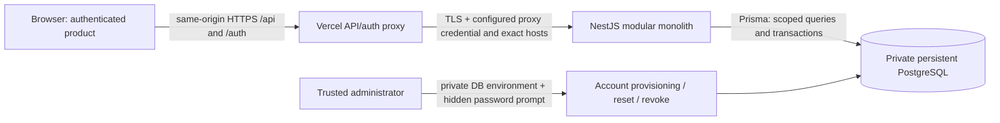
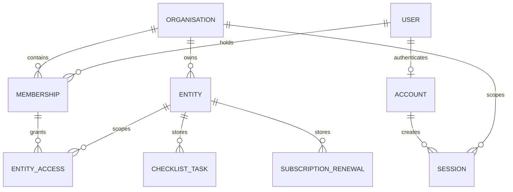

# Current FinAI architecture — 2026-10-22

This is the current implementation design, superseding the original proposals in backend-design.md. Source, contracts and executed verification remain authoritative. Product scope is the four implemented tools; financial accounting, banking and assistant simulations are excluded from the product build and are not approved accounting specifications.

## System and trust boundary



The frontend is a presentation client, not an authority for identity, roles or organisation access. The proxy forwards only allowlisted transport headers, overwrites trusted proxy headers, validates the exact public host and configured TLS backend, bounds request bodies, enforces an upstream deadline, and preserves JSON errors/request IDs. Secrets remain server-side. The backend does not trust Express forwarded-IP inference or browser persona/tenant headers.

Database sessions authenticate each request. Account disabled/expiry, active organisation membership and entity grants are server checks. A login alone grants no entity access. Every repository operation scopes organisation/entity and checks permissions; read-only permission suffices for calculation. Cookie mutations require exact Origin, JSON and CSRF. Cookies are Secure/HttpOnly/SameSite=Strict, rotate after login, expire after8h, and are backed by digests in PostgreSQL. Argon2id parameters and account commands are in RELEASE.md. PostgreSQL fixed-window budgets cover IP/account/global password work and user mutations across replicas; deployment capacity/ingress limits still require measurement.

## Application boundaries

```text
frontend/src/main.tsx
  product (default, build-time constant)
    app/ProductApp.tsx -> shared SessionGate, pure UI, four live tools
    lib/api.ts + checklist transport -> same-origin proxy
    no demo store/seeds/legacy router or fixture public assets
  demo (explicit local/test only)
    app/demo-entry.tsx -> legacy Redux provider/router/workflows
    never used after an API failure; Vercel-marked demo build refused

backend/src/
  app.ts                     composition, transport/auth middleware, health
  auth.ts/config.ts           sessions, rate limits, server configuration
  readiness.ts               completed migrations + critical-column probe
  *.controller.ts            strict transport validation / status translation
  *.service.ts               feature semantics / response serialization
  *.repository.ts            permission-scoped database queries / transactions
  payment-due-date.ts         pure validated calendar calculation
  errors.ts                  safe error envelope, request-ID-only failure logs
```

Pure UI lives in `components/ui/primitives.tsx` and PageHeader.tsx. Legacy Common.tsx/UI wrappers may depend on the demo store and are not imported by product code. Shared SessionGate context avoids nested authentication/logout controls. A session lifecycle revision prevents an old401 response from ending a newly authenticated session. Feature request generations/abort signals and mounted/scope checks prevent stale results or post-navigation success notifications. API responses are structurally and semantically checked before display; mutations confirm the server result before success. No live records, credentials or calculation inputs/results enter browser storage.

| Product route | Backend resource | Persistence and access |
| --- | --- | --- |
| `/close/checklist` | `/api/v1/checklist-tasks` and `/copy-previous-month` | ChecklistTask; entity read for list, write for mutations |
| `/tools/subscriptions` | `/api/v1/subscription-renewals` | SubscriptionRenewal; entity read for list, write/version for changes |
| `/tools/payment-due-date` | `/api/v1/payment-due-date-checks` | Stateless calculation; entity read permission |
| `/tools/invoice-duplicates` | `/api/v1/invoice-duplicate-checks` | Transient CSV/result memory only; entity read permission and CSRF |
| Shared session gate | `/auth/login`, `/auth/session`, `/auth/logout` | Account/Session/RateLimit; server identity, active membership and CSRF |

## Persistence and concurrency



Shared User/Organisation/Membership/Entity/EntityAccess define permission ownership. Account/Session/RateLimit are authentication infrastructure. Feature tables are ChecklistTask and SubscriptionRenewal. Tenant-aware foreign keys constrain records. Existing migrations are additive; no migration/reset is part of this hardening.

Checklist creates use UUID retry digests and transaction-scoped ID/month advisory locks. Previous-month copy uses the identical destination-month lock under READ COMMITTED; it checks destination emptiness after any lock wait, reads one source snapshot, checks the200-task cap and inserts a single atomic batch of new incomplete/version1 tasks. It never calls the completion/deletion dispatcher. Repetition against an occupied month conflicts; deleting every destination task permits deliberate copying again. Completion/deletion use version comparisons.

Subscription records use DATE fields, allowlisted updates and atomic expectedVersion compare/increment. Search is literal and bounded/paginated. Server-configured organisation timezones (UTC fallback) determine independent deadline indicators, not claims of payment/renewal/cancellation. Create IDs support safe identical retries; uncertain results trigger reload/review. Permissions are re-evaluated for subsequent requests; already authorized in-flight transactions may finish while an administrator changes grants.

Payment calculation has no business persistence. Strict real Gregorian dates0001–9999, terms integer0..365 and supplied as-of date feed UTC-midnight calendar arithmetic. Early years preserve their value, DST cannot shift calendar days, overflow is422, and status follows the signed difference. Client validation checks correspondence and arithmetic but never displays an invented fallback result.

## Operations and release decisions

- Separate frontend/backend manifests and deployment artifacts; one service and one database. No Redis, queues, paid APIs or microservices.
- Build-time product separation is enforced by asset scans and negative configuration checks, not by hiding demo navigation alone.
- Liveness is process-only. Readiness requires all three completed migrations, no unfinished migration and critical business/auth columns; it reads no business records. Session-mode health still requires trusted proxy headers.
- JSON limit16KiB (512KiB only for POST invoice-duplicate-checks; CSV itself128KiB/500 records), upstream deadline15s, proxy platform duration20s, backend request/header/keepalive limits and graceful shutdown are configured. Target ingress/TLS and replica/connection/hash capacity must be verified.
- Safe JSON errors/request IDs, no-store, bounded metadata logs and frontend CSP/anti-framing/security headers are implemented. Monitoring retention/alerts and production OS/container scanning remain operational gates.
- Backup, synthetic restore, additive migration/rollback and administrative procedures are in backend/RELEASE.md. Production restore rehearsal, session revocation after restore and RPO/RTO acceptance must precede release.
- No public deployment is performed by this work. A separately authorized preview must prove routing/static assets/API JSON, cookies/CSRF/tenant denial, readiness, persistence/restarts, operational limits and rollback on the actual target.

## Accepted decisions

1. Keep the existing NestJS/Prisma/PostgreSQL modular service; avoid a framework rewrite.
2. Default to the authenticated live tools; retain legacy demo sources only for explicit local regression/development. Do not rebrand simulations as real accounting.
3. Reuse administratively provisioned self-hosted sessions and entity grants; no paid identity service or browser-selected role authority.
4. Preserve additive data compatibility and existing transaction/version semantics; separate calendar-date deadlines from payment/financial events.
5. Release on evidence: application correctness checks and local HTTPS verification do not establish target deployment readiness or absence of every defect.

The invoice duplicate checker uses pure product UI imports and the shared authenticated product entry. It compares references only within the submitted file, stores no uploads/history and never mutates invoices. Result downloads quote/neutralize spreadsheet formula-like text. Old legacy-router fixtures remain separate. PR #4 reconciliation and combined verification: [invoice-merge.md](invoice-merge.md).
