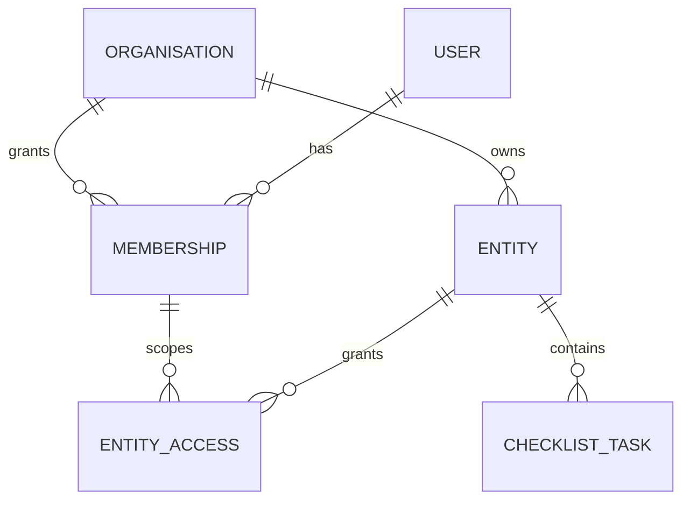

# Proposed backend architecture

Design dated 2026-10-19, grounded in `project-state.md` and reconciled with Prompt 02. The local checklist is implemented and Gates A–C are verified; future financial domains and production deployment/security remain proposals. See progress.md and review.md for actual evidence.

## Architecture and authority

One TypeScript NestJS modular monolith with PostgreSQL and Prisma as the sole ORM/migration system. Pin supported package/runtime/database versions with lockfile and container digest when Gate B starts; do not invent installed backend versions. Keep independent `backend/package.json`, lockfile, environment configuration and commands; no root workspace conversion or frontend relocation.

HTTP controller validates transport → domain service enforces membership/business invariants → repository executes scoped Prisma queries/transactions. Shared server validation must implement the OpenAPI constraints; generate DTO/types or enforce drift checks, rather than maintaining unchecked duplicate definitions. Global error translation produces safe `code`, `message`, `requestId`, optional field errors. Generate request IDs server-side, echo them on all responses, log route template/status/latency with redaction and bounded retention. Do not log bodies, tokens, connection strings or financial evidence.

Backend is authoritative only for live checklist data initially. Demo Redux/localStorage remain entirely browser-owned; there is no data migration from fixtures. Start with identity-context infrastructure and a checklist module. Do not scaffold empty future business services.

| Future family | Observed UI/source in frontend/src | Prerequisite gate |
| --- | --- | --- |
| Identity, organisations, entities, memberships | `app/Shell.tsx`, `features/Administration.tsx`, `Reports.tsx`; settings/entities routes | Verified identity, membership model, deny-by-default tests |
| Checklist/workflow tracking | `features/Close.tsx`, separate proposed `/close/checklist` | Gate B persistence/isolation, Gate C integration |
| Accounting kernel and audit | `features/Accounting.tsx`, `demo/selectors.ts`; `/accounting/*`, `/audit-log` | Independent finance owner approves money/currency/posting/reversal outputs; permission and atomicity tests |
| Receivables/payables/source documents | `features/Operations.tsx`; `/receivables/*`, `/payables/*`, `/revenue/*` | Accounting kernel, source idempotency and subledger reconciliation |
| Banking/reconciliation | `Operations.tsx`; `/banking/*` | Accounting plus authorized providers, import deduplication and exception workflow |
| Reporting/close controls | `Reports.tsx`, `Close.tsx`, `FinanceSnapshot.tsx`; `/reports/*`, `/entities/*`, `/close` | Canonical ledger, approved expected reports, explicit review/lock domain |
| Authorized integrations/automation | `Administration.tsx`; `/integrations`, `/automations/*` | Provider scopes, consent/revocation, idempotent jobs, audit and safe retries |
| AI proposals | `Assistant.tsx`; `/assistant` | Authorized data retrieval, proposal schema, explicit human approval and deterministic execution |

Future money uses exact integer minor units or fixed-precision decimal with explicit currency/rounding policy; never floating arithmetic for ledger values. Balanced posting is atomic, posted history immutable with linked corrections, period checks server-side and source ingestion idempotent. Reports/subledgers trace back to canonical posted entries. Human, integration and AI requests share permission checks. AI proposes; deterministic services validate and post. The demo store is evidence of UX, not a financial specification.

## First slice: persistent monthly checklist

Prompt 02 supersedes the provisional first slice: list, create with client UUID safe retries, set completion, confirmed versioned deletion, and completed/total/rounded percentage. Authenticated `/api/v1/entities` discovers authorized entities. Contract 1.0.0 freezes these shapes. Explicit month only; no review, evidence, locks or financial semantics.

Exactly one feature table: ChecklistTask(id UUID, organisationId, entityId, month SQL DATE/first day, trimmed title 1–200 Unicode characters, completed false, version 1, createdAt/updatedAt UTC, original create digest). Shared User/Organisation/Membership/Entity/EntityAccess records support authorization; no checklist event table or workflow engine. Index organisation/entity/month/createdAt/id and composite tenant-aware foreign keys. Membership determines read/write access; request actor is resolved from server-owned context, not supplied by clients; request logs contain safe operational metadata.

Create holds a PostgreSQL transaction advisory lock keyed consistently by entity/month, rechecks membership and count <=200, compares an immutable canonical create digest for UUID retries, and inserts atomically. Identical authorized retries return current task even after completion changes; conflicting payload returns 409; foreign IDs return 404. Deleted task identities have no tombstones and may be recreated explicitly. PATCH conditionally updates authorized task/version and increments version; DELETE uses quoted If-Match version. Update/delete races yield one successful mutation and safe conflict/not-found for the loser. Full list is one bounded snapshot; summary derives from the exact same rows, no pagination.

## Identity and deployment boundary

Local/test option: explicit server configuration selects seeded identity; bind API to 127.0.0.1 and reject startup on non-loopback bind, production NODE_ENV/deployment marker, or forwarded/proxied access. Reject caller-supplied identity/role override headers. No caller-selectable tenant, role or organisation body field. Local mode is not safe to expose behind a public reverse proxy; readiness remains false if the mode/environment/bind checks fail. Add tests for these combinations. Developer access uses a genuinely local browser/API or backend tests, not the public Vercel browser. Local seeded membership still goes through ordinary scoped services.

Production: verified OIDC access token in Authorization Bearer; validate signature with configured issuer/JWKS, pinned accepted algorithms, audience, expiry/not-before, and map issuer+subject to an active membership and entity permission. No public API until a provider and these tests exist. Invalid/missing token → 401; known same-tenant entity without action permission → 403; missing or foreign entity/task → 404 to avoid disclosure. No credentials in VITE_ variables, demo profile, X-Role or X-Tenant headers. Backend-generated requestId and safe error envelopes apply even to auth failures.

Prefer same-origin HTTPS: reverse proxy serves frontend static assets, routes `/api/v1/*` to private API, leaves other SPA deep links on index.html. Existing Vercel deployment requires an explicitly configured rewrite to a separate persistent API host and private managed PostgreSQL, or a later hosting decision; adding a backend directory creates neither. Do not enable the public checklist until Gate D. For separate origins allow only configured exact frontend origins (no wildcard), Authorization/Content-Type headers and GET/POST/PATCH/DELETE; no browser cookies or credentialed CORS in the bearer design. Keep access tokens in memory with verified provider flow (PKCE); do not reuse demo storage. Bearer-only endpoints reject cookie authentication, so ambient-cookie CSRF is not used. If a BFF/session cookie flow is chosen later, require Secure/HttpOnly/SameSite cookies, Origin verification and CSRF tokens before enabling mutations. CORS is not authentication.

Production operations proposal: multi-stage non-root Docker image, private DB/TLS, managed secrets (DATABASE_URL and identity config), database least privilege, ingress limits/timeouts, rate limits and body size limits. Separate liveness (process) from readiness (DB query, schema version, validated identity config); readiness fails closed on local identity. Health endpoints are infrastructure concerns to specify during Gate B, not extra product API promises. Run committed migrations as a controlled release job with locking/backups and compatibility review, not reset/seed on startup. Use expand/contract migrations for rollback; recover forward or restore deliberately when data changes are incompatible.

Backups: encrypted scheduled snapshots plus WAL/PITR, private access, monitored failures, documented operator ownership. Proposed targets RPO ≤15 min/RTO ≤4 h require restore rehearsal with timings and data checks; no guarantee exists. Rehearse restore into an isolated DB, run migration/version and tenant checks, verify task consistency and service read/write, record results. Retention, residency, monitoring destinations, incident owner and final targets are release decisions.

## Short decisions

### ADR 001 — single modular service (proposed)
Problem: broad demo has no backend foundation. Decision: NestJS/PostgreSQL/Prisma modular monolith with separate manifests. Trade-off: simple transactions/operations, coupled deployment. Revisit: measured scaling or team-boundary needs justify extraction.

### ADR 002 — separate checklist model (proposed)
Problem: four-state close approval cannot be represented as a completion boolean. Decision: new screen/DTO/table, no demo migration. Trade-off: two intentionally distinct UX areas. Revisit: approved workflow domain and explicit migration plan.

### ADR 003 — production identity gate (proposed)
Problem: demo has no authentication. Decision: local seeded loopback only; OIDC bearer plus memberships before public use. Trade-off: public live rollout blocked pending provider choice. Revisit: an approved BFF/session design with CSRF controls.

### ADR 004 — optimistic mutation conflicts (proposed)
Problem: users can overwrite each other's checklist completion. Decision: mandatory expectedVersion and atomic event write. Trade-off: UI must refetch/resolve 409. Revisit: Prompt 02 semantics or demonstrated need for more complex collaboration.

### ADR 005 — Prompt 02 reconciliation (accepted for local feature)
Problem: provisional routes omitted deletion, summaries and safe retries. Decision: contract 1.0.0 follows Prompt 02 flat routes, authenticated entity discovery, one feature table, immutable create digest, quoted If-Match deletion, and transactional 200-task cap. Trade-off: bounded list simplifies consistent progress; no event table, cursor or extra product. Revisit: requirements exceed the explicit cap or production identity is selected.
