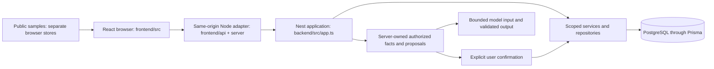

# Architecture and adding a product

Use this guide when extending **this FinAI application**. [The file catalog](repository-guide.md) explains every tracked file; [the root README](../README.md) explains setup; dated reports in `context/` record what was tested. This is a modular application with two separately installed packages, not a generic framework or a claim that every finance screen is a live product.

## Runtime and data boundaries

The adapter supports a remote HTTPS API or an embedded private backend package. In both modes the same Nest application enforces session, organisation/entity access, CSRF, validation and transactional business rules. Public samples never supply company identity. A model answer never directly grants financial authority.

| Area | Responsibility and extension point |
| --- | --- |
| `frontend/src/app/` | Browser composition, router and sample shell. Register module routes in `router.tsx`; keep company routes under the existing `/workspace` parent. |
| `frontend/src/features/<domain>/` | Product screens, validated clients, domain-specific presentation and styles. Existing top-level `Accounting.tsx`, `Operations.tsx` and similar files are preserved original sample modules. Prefer a feature folder for new work. |
| `frontend/src/components/`, `src/lib/` | Reusable controls, session lifetimes and shared transport. Share code here only when multiple features need the same behavior; keep product rules in their owning feature. |
| `frontend/src/features/workspace/` | Authenticated shell, current authorised company/source context and module navigation. Browser controls reflect capabilities; backend checks remain authoritative. |
| `frontend/api/`, `frontend/server/` | Server-only adapter, body limits, runtime bootstrap and separate public chat. These files may use Node/private configuration; browser source cannot import them. |
| `backend/src/app.ts`, `src/main.ts` | Composition root and listening entrypoint. Add controllers/providers to the existing root; preserve listener-free initialization for embedded/Vercel use. |
| `backend/src/<domain>/` | Authoritative controllers, validation, services and repositories. Existing flat checklist/subscription modules are compatibility paths, not a reason to add more unrelated code to them. |
| `backend/prisma/` | Shared database model and ordered migration history. Add domain-owned tables and additive migrations; never alter an already-applied migration to introduce a product. |
| `backend/scripts/`, application tests/scripts | Operator tools and synthetic verification. Operator tools use compiled backend modules; test fixtures must not become deployment servers or browser dependencies. |
| `contracts/` | Versioned schemas, examples and validators shared by both implementers. Generated payables OpenAPI has its own committed generator. |
| `docs/`, `context/` | Current architecture/file navigation versus dated decisions and measured evidence. Keep credentials and customer records in neither. |

Neither application source tree imports the other application or test/build output. Browser code imports browser-safe packages and code inside `frontend/src/`. Backend source imports code inside `backend/src/` and its server dependencies. Contracts define the interface; do not import backend implementations into a browser to reuse types. Generate or maintain validated consumer types within the consumer's feature instead.

## Add a product to the existing workspace

Use a name such as `<domain>` below as a placeholder, not a literal folder name. Start with the smallest useful end-to-end capability; do not copy the entire invoice feature or its large service/component files.

1. **Define the product boundary.** Record the owner, users, data source, company/entity scope, permissions, supported actions, retention and acceptance criteria in the task's context entry. Separate sample-only behavior from authenticated operations. State what the first slice actually supports.
2. **Define the contract first.** Add or extend the owning `contracts/<domain>.*` schema, safe examples and executable validator. Specify exact dates/money, paging, errors, permissions and retry/version behavior. Check whether the file is generated before editing. Review compatibility before changing an existing response.
3. **Add persistence when needed.** Extend `backend/prisma/schema.prisma` with explicit organisation/entity relationships and constraints. Add a new ordered migration. Test an empty database and reapplication of migration deployment. Setup/builds must not migrate or seed unknown databases automatically.
4. **Implement a backend feature folder.** Use `controller.ts` for strict transport validation, `service.ts` for business actions and `repository.ts` when that keeps persistence manageable. Keep pure validation/calculation in a small domain file. These are responsibility suggestions, not mandatory empty files. Reuse `Database`, server-derived identity, safe `ApiError` responses and transaction-scoped audits. Register controllers/providers in `src/app.ts`.
5. **Enforce permissions and write semantics.** Check membership and module/entity authority on every read/write. A body `entityId` is a requested scope, never an identity or grant. Use exact financial arithmetic, expected-version checks and locked transactions where required. Make retry IDs stable across uncertain outcomes; distinguish a rejected write from a possibly committed one. Include atomic audit/events in the same transaction when business history requires them.
6. **Build one frontend feature folder.** Keep UI, response schemas and its adapter together under `frontend/src/features/<domain>/`. Use the shared session/transport helpers where their contract fits; the invoice client retains special scanner/upload budgets. Cancel obsolete requests and fence late responses after scope/account changes. Show loading, empty, permission, validation, conflict and unavailable states explicitly. Never substitute samples after a private read fails.
7. **Wire navigation once.** Add the new child route under `/workspace` in `src/app/router.tsx` and its authorised navigation in `features/workspace/Workspace.tsx`. Use `useWorkspace()` for current validated context, not browser demo state. If adding a sample, give it an explicitly labelled public route and its own persistence key. Keep existing bookmarks and redirects working.
8. **Add FinAI capabilities deliberately.** If the product needs Assistant support, extend its versioned source/tool/proposal schema, authorised fact retrieval and controlled tests. Follow the existing invoice boundary in `backend/src/payables/assistant.ts` and `frontend/src/features/assistant/InvoiceAction.tsx`: the server constructs a bounded proposal, the user confirms, and the normal scoped/versioned service performs the action. Recheck authority and proposal freshness at confirmation; do not let model text choose unrestricted database commands.
9. **Verify the actual slice.** Add backend persistence/tenant/permission/version/retry regressions and a browser journey through the real API. Test adversarial amounts/dates/inputs, navigation during pending requests and failed/ambiguous saves where applicable. Add the suite to package scripts and CI. A new `*.spec.ts` file must be assigned to the intended Playwright configuration and excluded from unrelated default suites. Ports/artifact folders are shared: run browser suites sequentially.
10. **Finish documentation and release work.** Add one purpose row for every new file to `docs/repository-guide.md`, update relevant runbooks/configuration names and record commands actually run. Document new server-only variables in safe examples. Build/package through the existing adapter, inspect public assets, and verify the deployed commit using the operational handoff. Local green tests do not provision or verify production accounts, database, scanner or provider.

For large features, split cohesive subcomponents or domain operations as the feature grows and protect their behavior with tests. Avoid speculative base classes, generic finance engines, shared mutable state or empty scaffold folders. Introduce a shared abstraction after two real consumers establish its interface.

## Start an independent project

A new module sharing this company's sessions, database transactions and deployment belongs in the workspace flow above. A genuinely independent application is best created as a separate repository with its own dependencies, CI, runtime settings, migration ownership and deployment. This repository is not configured to deploy arbitrary additional apps.

If a later requirement explicitly needs several independently deployed applications in this repository, first make that an architecture change: define their directories, owners, per-app manifests/lockfiles, shared-package API/versioning, CI path selection and separate Vercel roots/Docker contexts. Extend repository checks and this catalog for that layout. Do not place a second app under a feature folder, silently merge package lockfiles, import another repository's source, or assume the current Vercel root deploys it.

## Conventions and verification

- React components use existing PascalCase naming; feature directories use lowercase domain names. Follow each neighboring module's established convention. Prefer clear names over abbreviations and broad `utils.ts` files.
- Comments explain authority, lifetime, retry, financial and cleanup invariants. Function/field names should explain ordinary mechanics. JSON/lockfiles and binary references are documented in the catalog rather than being modified to add comments.
- `.editorconfig` supplies UTF-8, LF, final newline and two-space indentation defaults. Python retains four-space indentation; Markdown preserves intentional trailing hard breaks. Use scoped Prettier checks; do not reformat unrelated files.
- Frontend `typecheck` covers browser code, tests, Vite, every `playwright*.config.ts` and the separate NodeNext `api/`/`server/` pass. Development fixture scripts also have lint and executable suite coverage; this is not a claim that every script has full static typing.
- From the root, run `npm --prefix frontend run test:repository` and `npm --prefix frontend run check:repository`. Stage intended deletions before checking their removal from the Git index. The check includes tracked and new nonignored files, rejects missing/duplicate/stale file purposes and accidentally tracked environment/generated files, and parses application imports with the pinned TypeScript compiler.
- Import checks cover declarations, re-exports, import types, literal dynamic imports and `require` in both application source trees. They reject browser Node/server packages and relative/Vite-root imports outside the owning source tree. Computed imports require a reviewed static design. There are no source aliases today; introduce alias resolution in the guard and tests before using aliases. These checks are maintenance guardrails, not a sandbox or a complete bundler/security audit.
- Both CI workflows run the repository check and its negative tests after locked installs. Use the [complete verification map](repository-guide.md#verification) for app/backend/contracts/runtime/recovery checks appropriate to an actual product change. Keep manifests and lockfiles separate; no new root package manager/framework is needed for this guide.
